

  

<h1 align="center">呆呆面板</h1>

  <em>呆呆面板本机版的内置面板源码，安装包只从本仓库 Release 发布</em>

  
  
  
  

  

---

本目录是呆呆面板本机版仓库中的内置面板源码，版本与根目录 `VERSION.json` 一致，当前为 **v2.0.7**。产品介绍、安装包和更新说明以仓库根目录 README 为准。

本仓库不发布 Docker 镜像、Windows 安装包或 Magisk 模块。请只从 [tall-1997/daidai-panel-native Releases](https://github.com/tall-1997/daidai-panel-native/releases) 下载 Android 安装包。
呆呆面板 (Daidai Panel) 是一款轻量级定时任务管理平台，采用 Go (Gin) + Vue3 (Element Plus) + SQLite 架构，专注于脚本托管与自动化任务调度。支持 Python、Node.js（含 `.js` / `.mjs`）、Shell、TypeScript、Go 等多语言脚本的定时执行与可视化管理，内置 22 种消息推送渠道、订阅管理、环境变量、依赖管理、Open API 等功能。Docker 一键部署，开箱即用。

## 在线演示

想先看看效果再决定装不装，直接打开 **<https://linzixuanzz.github.io/daidai-panel/>**，点「进入演示环境」就能逛完整面板 —— 不用注册，也不用装 Docker。演示站跟随每个正式版自动更新，打开看到的就是最新正式版的界面。

里面新建任务、编辑脚本、拖拽排序都会真的生效，所以更要先说清楚它是什么：

> **演示站不是一台真实运行的面板**，而是面板前端单独打包后配上浏览器内的模拟数据，没有后端，也不会真的执行任何脚本。 
> **你的所有操作只存在你自己的浏览器里，刷新页面即恢复初始状态**，不会保存，也不会被别人看到。 
> 因此**请不要在演示站里填写真实的 Cookie、密码或推送密钥**——那里没有能托管它们的服务端，填了也只是白填。

## 功能特性

- **定时任务** — Cron 表达式调度，支持重试、超时、定时停止、任务依赖、前后置钩子
- **脚本管理** — 在线代码编辑器，支持 Python、Node.js（含 `.mjs`）、Shell、TypeScript、Go，拖拽移动文件
- **执行日志** — SSE 实时日志流（自动跟随最新输出，往上翻即暂停），历史日志查看与自动清理
- **环境变量** — 分组管理、拖拽排序、敏感值默认遮蔽、批量导入导出（兼容青龙格式）
- **订阅管理** — 自动从 Git 仓库拉取脚本，支持定期同步
- **依赖管理** — 可视化安装/卸载 Python (pip)、Node.js (npm) 依赖，以及 **Linux 系统包**（自动识别 `apk` / `apt` / `dnf` / `yum` / `microdnf` / `zypper`）；页面工具条里还有管理员专用的网页版「系统命令行」
- **通知推送** — Bark、Telegram、Server酱、企业微信、钉钉、飞书等 22 种渠道
- **开放 API** — App Key / App Secret 认证，支持第三方系统对接
- **MCP 服务** — 内置 MCP，Claude、Cursor 等 AI 客户端连上后可以直接查任务、看日志、巡检失败任务；管理员放开写入后还能运行任务、改变量（默认关闭，[使用说明](./docs/mcp.md)）
- **系统安全** — 双因素认证 (2FA)、IP 白名单、登录日志、多设备会话管理
- **数据备份** — 一键备份与恢复，支持每天/每周/每月定时备份
- **系统监控** — 实时 CPU / 内存 / 磁盘监控，任务执行趋势统计

<b>点击展开查看详细功能</b>

### 定时任务管理
- 标准 Cron 表达式调度
- 常用时间规则快捷选择
- 任务启用/禁用状态切换
- 手动触发执行
- 任务超时控制与重试机制
- 前后置钩子（任务依赖链）
- 多实例并发控制

### 脚本文件管理
- 在线代码编辑器（语法高亮）
- 支持创建、重命名、删除文件
- 支持文件上传与拖拽移动
- 脚本版本管理
- 调试运行与实时日志输出
- 支持 `.mjs` 脚本调试与任务执行

### 执行日志
- SSE 实时日志流，自动跟随最新输出（往上翻即暂停，滚回底部恢复）
- 执行状态追踪（成功/失败/超时/手动终止）
- 执行耗时统计
- 日志自动清理策略

### 环境变量
- 安全存储敏感配置
- 名称像凭据的变量（含 TOKEN、COOKIE、PASSWORD 等）默认遮蔽显示，可切换为全部遮蔽或全部明文
- 分组管理与拖拽排序
- 批量导入导出
- 任务执行时自动注入

### 订阅管理
- Git 仓库自动拉取
- 定期同步（Cron 调度）
- SSH Key / Token 认证
- 白名单/黑名单/依赖规则过滤（对应青龙 `ql repo` 的第 2/3/4 个参数，`,` 与 `|` 均可作分隔符）
  - 匹配方式：普通片段按「子串包含」匹配（不是 glob）；含 `^ $ ( ) [ ] { } ? \` 或 `.*` `.+` 的片段按正则匹配仓库内的相对路径（不锚定，路径分隔写 `/`），例如 `^jd[^_]` 只命中仓库根目录下的 `jdCookie.js` 这类文件。想按字面匹配这些字符时用 `\` 转义；正则写错会在保存时直接提示。
  - 白名单不仅筛选任务，还会参与实际检出范围：只有命中白名单的文件会落盘并建成定时任务；填了「指定子目录」时按子目录检出，白名单只决定建不建任务。
  - 建任务时，脚本需在头部声明 cron；未声明时按「订阅设置 → 默认 Cron 规则」建任务，留空则不建（`v3.2.9` 起）。
  - 用了正则时会改为检出完整仓库（git 的检出规则表达不了正则；多占些磁盘，建任务的范围不变）：依赖规则里有正则片段就会，填了「指定子目录」也一样，但仍只给子目录里的脚本建任务；白名单里的正则片段只在没填「指定子目录」时才会。
  - 依赖规则同样参与检出：命中的文件会被拉取到脚本目录供主脚本调用，但**不会**建成定时任务（同时命中白名单的照常建，所以白名单留空时依赖规则不影响建任务），主脚本 require 的辅助库填这里即可，不必再塞进白名单。
  - 黑名单对两者都生效（其中的正则片段只让命中的文件不建任务，不减少落盘）；白名单留空时视为全部命中；如果「指定子目录」也没填，本来就检出完整仓库，依赖规则不起作用。

### 消息推送
- 22 种主流推送渠道
- 任务执行结果通知
- 系统事件告警
- 自定义推送模板

### 系统设置
- 双因素认证 (2FA / TOTP)
- IP 白名单
- 登录日志与多设备会话管理（可配置网页端 / APP 端最大会话数）
- 数据备份与恢复（含视图数据）
- 定时备份（每天 / 每周 / 每月）
- 面板标题与图标自定义

## 效果图

<b>点击展开查看界面截图</b>

| 功能 | 截图 |
|------|------|
| 仪表盘 | 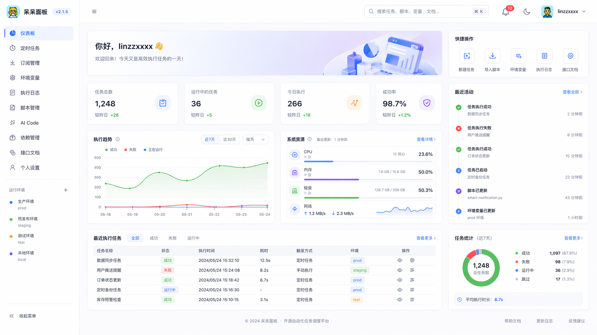 |
| 定时任务 | 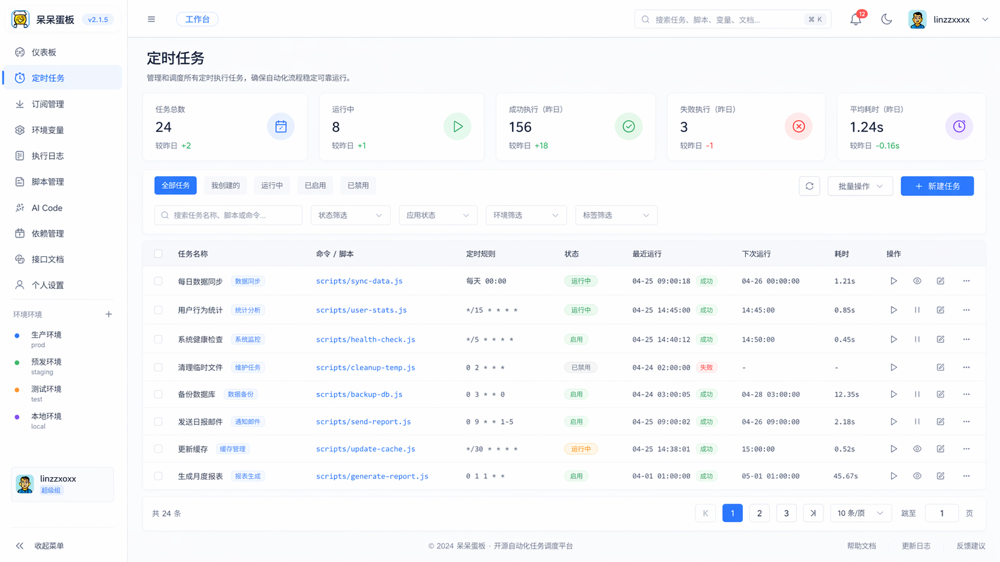 |
| 执行日志 | 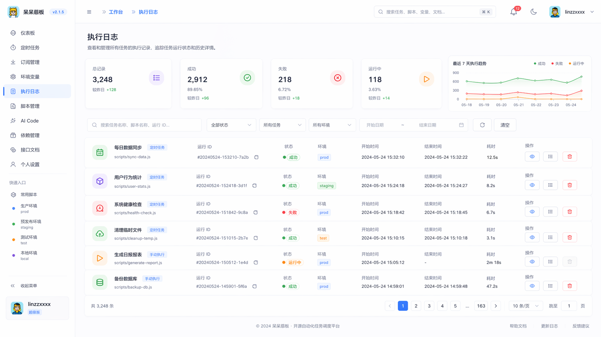 |
| 用户管理 | 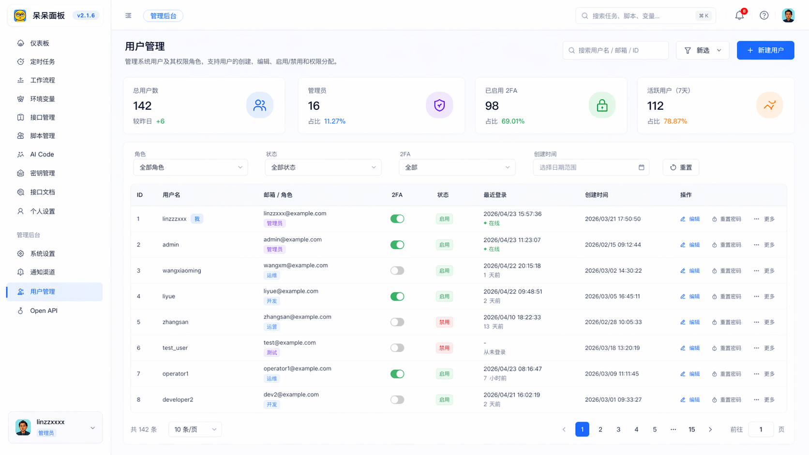 |
| 脚本管理 | 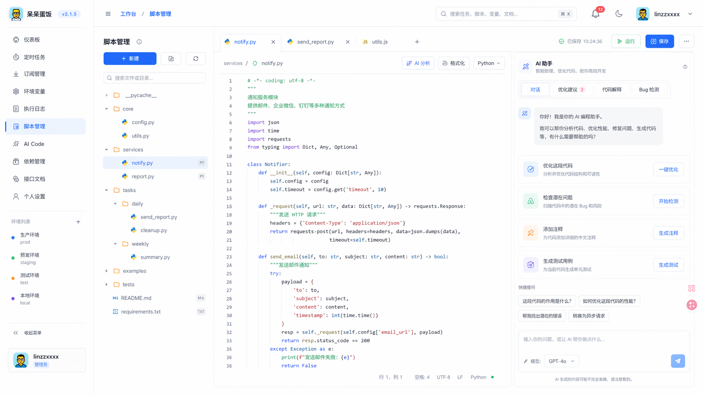 |
| 环境变量 | 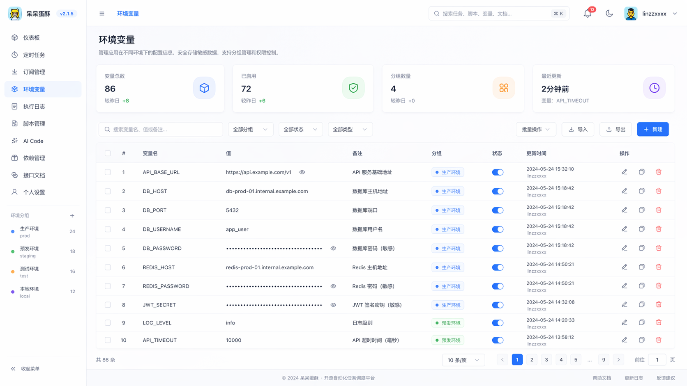 |
| 订阅管理 | 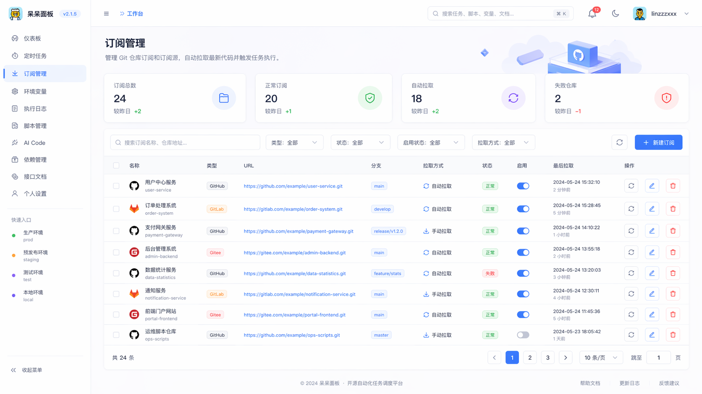 |
| 通知渠道 | 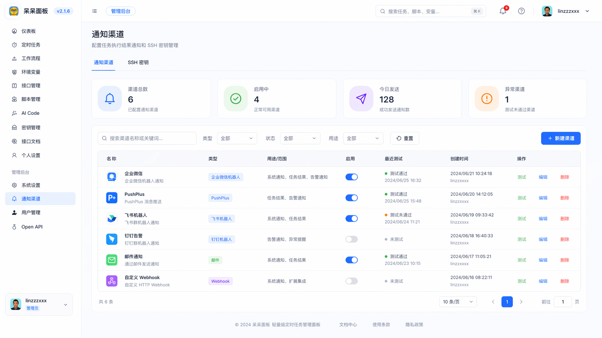 |
| Open API |  |
| 依赖管理 | 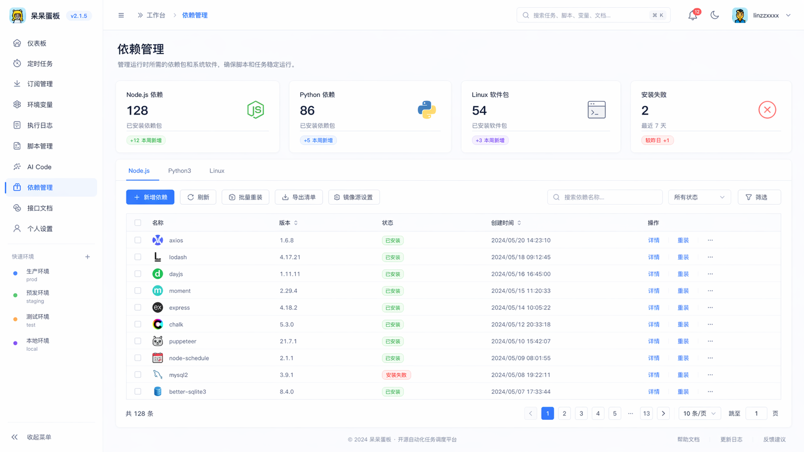 |
| 系统设置 | 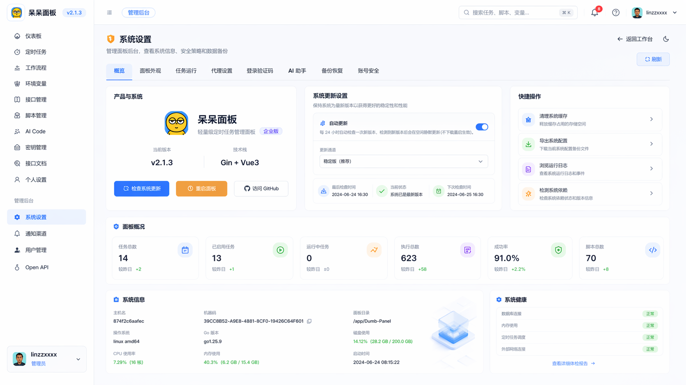 |
| 个人设置 | 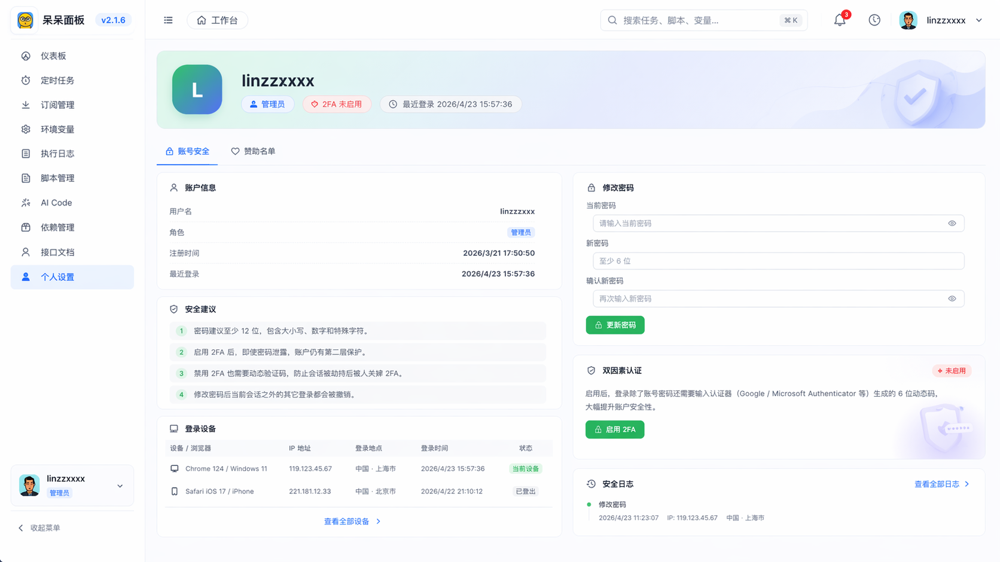 |

## 安装与发布

本目录是仓库内的面板源码，不是独立安装包。

本仓库不发布 Docker 镜像、Windows 安装包、Linux 二进制包或 Magisk 模块，也不提供其他仓库的下载地址。请只从 [tall-1997/daidai-panel-native Releases](https://github.com/tall-1997/daidai-panel-native/releases) 下载 Android 安装包。

产品介绍和更新说明见仓库根目录 [README.md](../README.md) 与 [CHANGELOG.md](../CHANGELOG.md)。

## LICENSE

Copyright © 2026, [linzixuanzz](https://github.com/linzixuanzz). Released under the [MIT](LICENSE).
